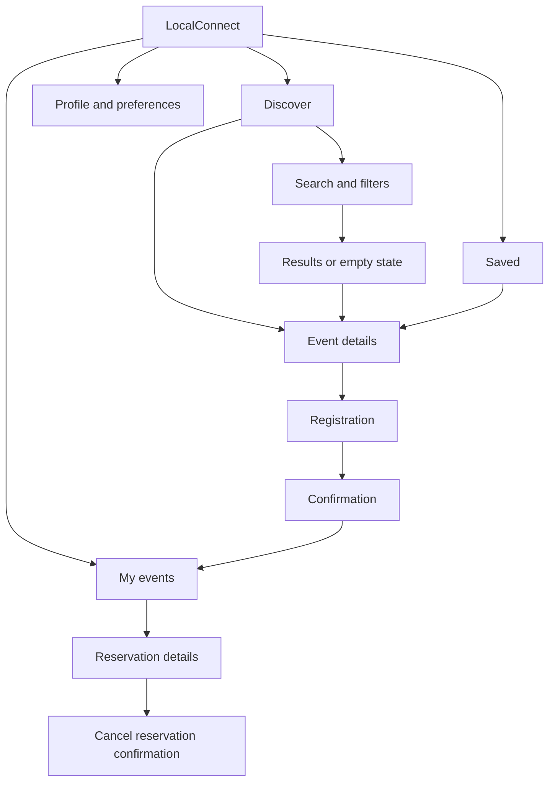
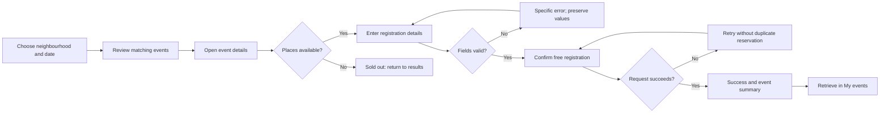

# LocalConnect — Information architecture and interaction specification

Prepared 10 November 2026 • Proposed design based on the assignment and labelled assumptions

## Sitemap

## Critical user flow

## Five critical screens

| Screen | Hierarchy and content | Primary action | States |
| --- | --- | --- | --- |
| Discover | Neighbourhood, heading, search, date/price filters, event title/date/distance/price | View event | Default, filtered, no results, loading/error |
| Event details | Title, date/time zone, venue, price, organiser, description, eligibility, access and cancellation details | Register free | Available, sold out, already registered |
| Registration | Event summary, labelled name and email, required-field help | Confirm registration | Empty, invalid email, submitting, retry |
| Confirmation | Explicit reservation status, event date/venue, reference, next step | View My events | Successful registration only |
| My events | Upcoming reservations with date, venue and status | View reservation | Upcoming, cancelled, empty |

Sample content is fictional: Neighbourhood garden morning, Saturday 14 November 2026, 8–10 AM IST, Indiranagar Community Garden, Bengaluru, free admission. Capacity, venue and organiser details must be labelled sample data in any prototype. Do not use invented claims such as “verified organiser” without a verification mechanism.

## Interaction and content rules

- Users can enter a neighbourhood manually without granting location permission.
- Apply search and filters together; display active values and a Reset action. Empty results retain the query and suggest clearing filters.
- Returning from details preserves the result state and scroll position where practical.
- Saving an event and registering are separate states with distinct labels.
- Registration fields use visible labels and purpose-appropriate input types. Explain errors beside fields, move focus to the first error, and preserve input.
- Show a reservation only after confirmed success. Prevent repeated submission while pending and avoid creating duplicate reservations.
- My events provides a route back to the event. Cancellation uses a separate confirmation and changes status explicitly.
- Prototype forms must use sample details and explain whether storage is local. Do not request actual payment or identity documents.

## Accessibility acceptance criteria for implementation

Keyboard access throughout; visible focus; meaningful button names; non-colour status indicators; readable text under zoom; announced errors and success; sufficient contrast checked on the selected palette; generous mobile touch targets; reduced-motion support. A map concept must also have an equivalent list. These are proposed requirements, not a claim of accessibility conformance.

## Low-fidelity layout plan

Discover: location → heading → search → filters → event results → bottom navigation.

Details: back/save → image → title → practical details → description/access → registration action.

Registration: back → event summary → two labelled fields → clear price → confirm action.

Confirmation: success heading → reservation summary → My events action.

My events: heading → upcoming/cancelled reservations → reservation detail.

## Figma handoff plan

Create pages: 01 Research, 02 IA and flows, 03 Lo-fi, 04 Components, 05 Hi-fi, 06 Prototype, 07 Testing. Use 390 × 844 mobile frames with scrolling for longer content. Create reusable button, field, event-row, filter, navigation and status components. Add normal/focus/error/disabled/pending states. Link all five critical screens and the error/recovery paths. Provide a viewable Figma prototype link and exported screen PDF/PNGs; a coded prototype alone does not meet the explicit Figma requirement.
